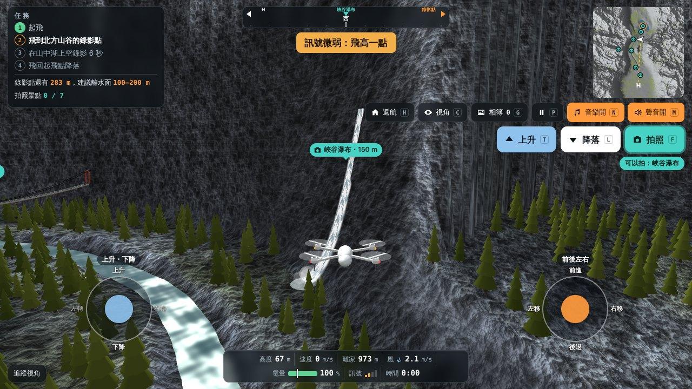

# 山谷空拍 Valley Drone Flight

在瀏覽器裡玩的 3D 無人機空拍遊戲。從風景區入口起飛，沿著溪谷飛進山裡，拍下沿途的景點，到山中湖上空錄一段空拍影片，再平安飛回起飛點降落。

A browser-based 3D drone flying game: take off, photograph scenic spots along a mountain valley, film the lake, and land back home.

**▶ 線上玩 Play：<https://vicjuan.github.io/valley-drone-flight/>**（電腦、iPhone、iPad 都可以）



## 玩法

**任務**：起飛 → 飛到山谷深處的山中湖 → 在湖面上空錄影 6 秒 → 飛回起飛點降落。

**7 個拍照景點**：登山山屋、千年神木、峽谷吊橋、峽谷瀑布、湖畔涼亭、山中湖、山頂氣象站。飛到景點附近、把機頭對準它，按「拍照」就會收進相簿。

**三個挑戰**

| 狀況 | 會發生什麼 | 怎麼應付 |
| --- | --- | --- |
| 強風 | 飛得越高風越大，飛機會被吹偏，也更耗電 | 降低高度 |
| 電量 | 電量用完馬達就停，飛機直接掉下來 | 電量條上的白線是飛回家需要的電，快碰到白線就返航 |
| 訊號 | 山擋在操作員和飛機中間就會斷訊，斷線 2.5 秒會自動返航 | 飛高一點，讓山不要擋住 |

降落時看三顆星：錄到湖景並平安降落、剩餘電量 25% 以上、全程沒有因斷訊被迫返航。

## 操作

| | 鍵盤 | 畫面上（滑鼠或觸控） |
| --- | --- | --- |
| 上升／下降 | W／S | 左邊搖桿上下推，或按住「上升」 |
| 左轉／右轉 | A／D | 左邊搖桿左右推到底 |
| 前後左右移動 | 方向鍵 | 右邊搖桿 |
| 一鍵起飛／降落 | T／L | 「上升」點一下／「降落」 |
| 拍照／相簿 | F／G | 「拍照」／「相簿」 |
| 自動返航 | H | 「返航」 |
| 切換視角 | C | 「視角」（追蹤、機載鏡頭、操作員） |
| 暫停（可調音量） | P 或 Esc | 暫停鍵 |
| 聲音／背景音樂 | M／N | 喇叭鍵／音樂鍵 |

也支援遊戲手把（美國手 Mode 2 配置）。

## 執行

- 直接用瀏覽器打開 `index.html` 就能玩，需要網路來載入 three.js 和字型。
- 也可以在這個資料夾開一個本機伺服器：

  ```bash
  python3 -m http.server 8000
  ```

  然後打開 <http://localhost:8000>。
- 放上 GitHub Pages：在 repo 的 **Settings → Pages**，Source 選 **Deploy from a branch**，分支選 `main`、資料夾選 `/ (root)`。

### 在 iPhone、iPad 上玩

放上 GitHub Pages 之後，用 Safari 打開網址就能玩，畫面上會出現兩個搖桿和「上升／降落／拍照」按鈕。

- 想要全螢幕：在 Safari 按「分享」→「加入主畫面」，之後從主畫面的圖示打開，就不會有網址列。
- 建議橫著拿，畫面比較寬。
- 聲音要在按下「開始飛行」之後才會出現；iOS 17 以上就算側邊靜音開關打開也會有聲音，較舊的 iOS 要把靜音關掉。
- 中文語音提示會用裝置內建的中文語音。

## 技術

- HTML、CSS、JavaScript，沒有用框架，也不需要建置步驟
- [three.js](https://threejs.org/) r128（WebGL），地形、水面、天空、瀑布是自己寫的 GLSL shader
- 地形用雜訊函數程序化產生，並預先算好陰影
- 飛行模型、風、電量、訊號遮擋、自動返航、碰撞都是自己寫的
- Web Audio API 即時合成螺旋槳聲、風聲、水聲、音效和背景音樂
- Web Speech API 播放中文語音提示（需要裝置有中文語音）
- Canvas 2D 產生岩石紋理、小地圖、羅盤和照片
- 鍵盤、Pointer Events（滑鼠／觸控搖桿）、Gamepad API

## 檔案

```
index.html             頁面和介面
manifest.webmanifest   加入主畫面用的設定
icons/                 主畫面圖示
style.css              樣式
src/core.js            地形、風、訊號、電量、飛行模型、自動返航、任務規則（不碰畫面）
src/game.js            3D 場景、景點、拍照與相簿、操作、聲音、介面
docs/                  說明用的截圖
```

## 授權

程式碼以 [MIT License](LICENSE) 釋出。

- three.js（MIT）由 cdnjs 載入
- 字型 Noto Sans TC、Noto Serif TC、Azeret Mono（SIL Open Font License）由 Google Fonts 載入
- 地形、模型、紋理、音樂和音效都由程式產生，沒有使用外部素材
